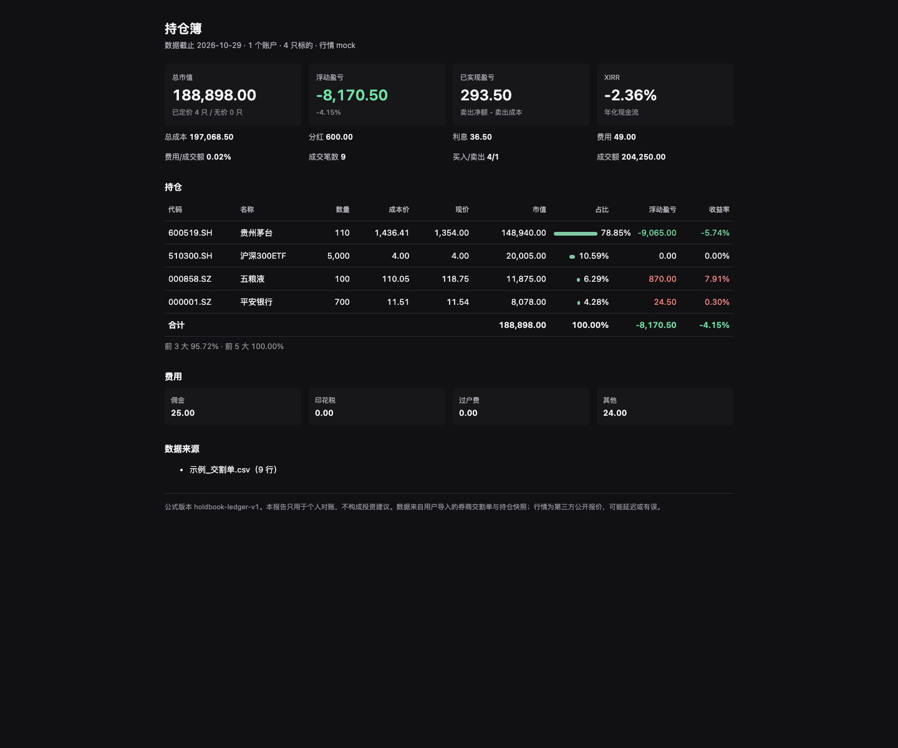

<div align="center">
  
  <h1>持仓簿 Holdbook</h1>
  <p>把券商交割单变成一份能逐行核对的持仓成本账本。</p>
  <p><a href="README_EN.md">English</a> · 简体中文</p>
  <p>
    
    
    
    
  </p>
</div>



## 这是什么

持仓簿是本地运行的 A 股持仓对账工具：导入券商导出的 CSV 交割单，再导入一张持仓快照，核对“账上数量/成本”和“券商快照”的差异，最后生成单文件 HTML 报告。

它解决的是一个小而具体的问题：**同一个投资者在多个券商账户里持有同一批股票/ETF，交割单、分红、送转、费用和券商显示的成本对不上，而券商 App 只给一个总数。**

- 谁用：同时用 1–3 个 A 股账户、每月或每季度愿意花十分钟核对一次的个人投资者。
- 不解决：自动交易、行情预测、基金穿透、税务申报。
- 默认完全离线：只有显式 `--market live` 才会请求腾讯公开行情；测试和演示用 `mock`。

## 使用前须知

- **数据在你自己手里。** 库默认在 `~/.local/share/holdbook/holdbook.db`，目录权限 `0700`，数据库 `0600`；没有账号、云同步、遥测或上传。
- **只吃 CSV。** 不解析券商 PDF/Excel，不连券商 API；CSV 列名支持常见别名，编码支持 UTF-8/GB18030。
- **只支持 A 股股票、ETF、可转债。** 不支持基金穿透、期权、期货、融资融券、港股/美股、多币种。
- **行情是可选装饰。** 默认 `off`；`mock` 用内置价格表；`live` 用腾讯公开报价，可能延迟或失败，失败时报告标注“无价”，不会编造价格。
- **报告含真实持仓。** 生成的 HTML 是本地文件，转发前请自己确认；程序不主动发送任何内容。
- **不是投资建议，也不是税务/合规工具。** 成本和盈亏按你导入的交割单重放，券商口径差异需要你自己核对。

### 适用于

1. 两三个券商账户，想把同一只股票的数量、成本、已实现盈亏对齐。
2. 每月从券商导出交割单和持仓，做一次数量/成本对账。
3. 想离线保存一份可读的 HTML 持仓报告，而不是只看 App 的总资产。
4. 想算一个基于真实现金流（含费用、分红）的 XIRR。

### 不适用于

1. 想自动同步券商、盘中实时估值或一键下单。
2. 想看基金底层持仓穿透、行业暴露或组合优化。
3. 期权、期货、融资融券、港股/美股、多币种账户。
4. 需要券商级清算、税务申报或审计底稿。

## 功能

完整规则与边界见 [docs/features.md](docs/features.md)；接口契约见 [SPEC.md](SPEC.md)。

- **导入交割单**：买卖、分红、送转、配股、中签、费用、利息、转账；按行校验，行级错误不阻塞其他行。
- **导入持仓快照**：代码、数量、成本价、市值；同账户同日按代码覆盖。
- **对账**：7 种状态（一致、账上少、账上多、只有账本、只有快照、成本不一致、快照无成本），带可操作的提示。
- **成本重放**：移动加权平均，买入费用计入成本，卖出按“先乘后除”的 12 位内部精度计算，避免逐笔舍入漂移。
- **报告**：文本、单文件 HTML（亮/暗/375px）、JSON；总市值、成本、浮动/已实现盈亏、分红、利息、费用、费用率、集中度、XIRR。
- **可核对**：`explain CODE` 逐笔重放一只标的；`check` 对账；`status` 看库状态。
- **可恢复**：`backup` 生成一致副本；`reset --yes` 清空；所有写入用事务。

## 快速开始

### 环境

- Python 3.11 或更高（开发与测试用 3.13.5）。
- 不需要数据库服务、Node、Docker 或任何 API key。
- macOS / Linux / Windows 均可；命令中的路径按你的系统替换。

### 安装

从源码目录安装（推荐隔离环境）：

```bash
python3 -m venv .venv
. .venv/bin/activate
pip install .
holdbook --version
```

或者用 pipx：

```bash
pipx install .
```

### 先看一个真实可运行的演示（不联网）

```bash
holdbook demo --dir holdbook-demo
```

它会生成 `holdbook-demo/data/`、示例交割单/快照和 `holdbook-demo/report.html`。示例快照故意比账本少 10 股，用来展示对账差异；报告里的行情全部来自内置 `mock` 表。

### 用自己的数据

1. 从券商导出**交割单 CSV** 和**持仓 CSV**（列名不用改，常见别名都认）。
2. 初始化并导入：

```bash
holdbook init
holdbook import 交割单.csv --account 华泰 --broker 华泰证券
holdbook snapshot 持仓.csv --account 华泰 --as-of 2026-10-29
holdbook check
holdbook report --market mock
```

3. 报告默认打印文本；加 `--format html` 才写到 `~/.local/share/holdbook/reports/report-<日期>-<时间>.html`，也可用 `--format html --out report.html` 指定路径，`--open` 直接打开。

最小交割单只需要 `日期,操作` 两列；数量、价格、金额、费用按需给。持仓快照只需要 `代码,数量`；成本价和市值可选。详细列名和校验规则见 [docs/features.md](docs/features.md#交割单-csv)。

### 第一次使用建议

- 先 `holdbook demo` 看报告长什么样，再换自己的 CSV。
- 第一次 `import` 加 `--dry-run`，确认“读取/新增/跳过/错误”行数再正式写。
- 第一次 `check` 不要加 `--strict`，先看差异提示；确认账本无误后再把它放进脚本。
- 行情先用 `--market mock` 或 `off`，确认成本/数量对了再开 `live`。

## 命令

| 命令 | 作用 |
|---|---|
| `holdbook init` | 建库和报告目录；幂等 |
| `holdbook import FILE... --account NAME [--broker NAME] [--dry-run]` | 导入交割单 |
| `holdbook snapshot FILE --account NAME [--as-of DATE] [--dry-run]` | 导入持仓快照 |
| `holdbook check [--account NAME] [--as-of DATE] [--strict]` | 对账；`--strict` 有差异退出 3 |
| `holdbook report [--account NAME] [--as-of DATE] [--market off\|live\|mock] [--prices FILE] [--format text\|html] [--out PATH] [--open]` | 生成报告 |
| `holdbook explain CODE [--account NAME] [--as-of DATE]` | 逐笔重放一只标的 |
| `holdbook status` | 库路径、账户、导入、快照、标的数 |
| `holdbook backup [--out PATH]` | `VACUUM INTO` 一致副本 |
| `holdbook reset --yes` | 删除库（保留目录和其他文件） |
| `holdbook demo [--dir PATH]` | 生成离线演示 |
| `holdbook version` / `--version` | 版本 |

全局参数：`--data-dir PATH`、`--json`、`--today YYYY-MM-DD`、`--quiet`、`-v/--verbose`。退出码：`0` 成功，`1` 运行/数据错误，`2` 输入/配置错误，`3` `check --strict` 有差异，`4` 行情不可用。

## 数据与恢复

- 默认数据目录：`~/.local/share/holdbook`；可用 `HOLDBOOK_DATA_DIR` 或 `--data-dir` 改。
- 默认库：`<data_dir>/holdbook.db`；可用 `HOLDBOOK_DB_PATH` 单独指定。
- 报告目录：`<data_dir>/reports`。
- 备份：`holdbook backup`，默认写 `<data_dir>/holdbook-backup-<时间>.db`；不覆盖已有文件。
- 清空：`holdbook reset --yes`，只删 `holdbook.db`、`-wal`、`-shm`。
- 升级前先备份；库 schema 版本为 1，遇到更高版本会拒绝打开而不是猜。

## 性能（实测）

条件：macOS arm64、Python 3.13.5、SQLite 3.49.1、SSD；10,000 行交割单、50 只标的、单账户；不联网，`report --market off`。

- `import`：0.63 秒；库 3.5 MB。
- `report --json`：0.42 秒。
- 并发/大文件不是目标；单文件上限 100 MiB、20 万行，超过会拒绝。

这些数字只说明本机量级，不是承诺；你的 CSV 列数、费用字段和磁盘会影响结果。

## 开发与测试

```bash
python3 -m unittest discover -s tests -v
```

当前 96 个测试，全部离线：临时目录、SQLite 临时库、本地假 HTTP 服务、`HOLDBOOK_NOW` 固定时钟；不使用固定 sleep。模块划分和发布检查见 [docs/development.md](docs/development.md)。

## 文档

- [功能与 CSV 规则](docs/features.md)
- [开发与测试](docs/development.md)
- [外部接口核实](docs/external-apis.md)
- [实现偏离记录](docs/deviations.md)
- [本地部署与运维](docs/deploy.md)
- [规格契约](SPEC.md) / [设计规范](DESIGN.md)
- [变更记录](CHANGELOG.md)

## 许可

MIT，见 [LICENSE](LICENSE)。

## 免责声明

本工具按“导入什么算什么”重放，不保证与任一券商/税务口径完全一致；行情来自第三方公开接口，可能延迟、缺失或被篡改。报告只用于个人对账，不构成投资建议。使用前请备份原始交割单。
